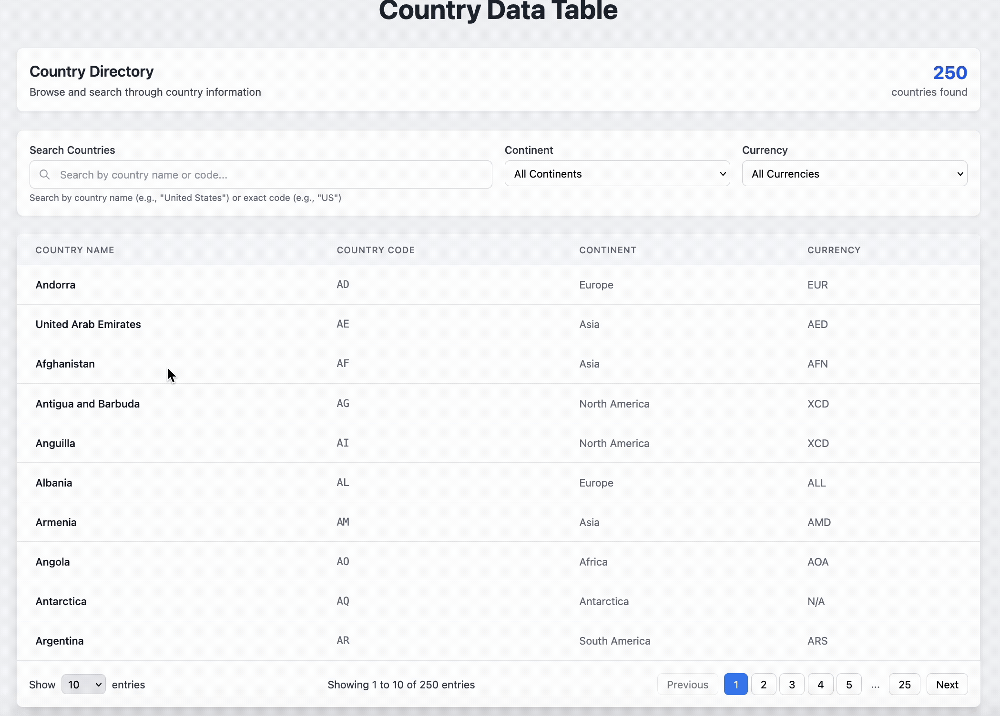

# Country Data Table

[](https://github.com/rveruna/country-data-table/actions/workflows/ci.yml)
[](https://github.com/rveruna/country-data-table/actions/workflows/codeql.yml)

**[Live demo](https://rveruna.github.io/country-data-table/)**, which uses the real Countries API. Try [Europe, searching for "ger"](https://rveruna.github.io/country-data-table/?continent=Europe&search=ger): the URL is the state, so any view can be shared.

A responsive table of the world's countries with filtering, search, pagination and shareable URLs. Built with React, TypeScript, Recoil and Tailwind CSS, with a small `fetch`-based GraphQL client. It scores **100 on all four Lighthouse categories** (performance, accessibility, best practices and SEO, on simulated mobile) and ships 86 kB of JavaScript gzipped; see [docs/performance.md](docs/performance.md) for how that was measured.

<p align="center"></p>

Data comes from the public [Countries GraphQL API](https://countries.trevorblades.com/).

## What it does

- Table of country name, code, continent and currency
- Pagination with 10, 20, 50 or 100 rows per page
- Filters for continent and currency
- Search that matches an exact country code or any part of a country name, debounced by 300 ms
- Page, filters and search are kept in the URL, so a view can be shared and survives a refresh
- Skeleton loading, an error state with a retry button, an offline banner and an error boundary
- Layout adapts to screen size with Tailwind breakpoints

## Run it

```bash
npm install
npm run dev       # http://localhost:5173
npm run build     # type-check and production build
npm run lint
npm run format    # Prettier
npm test          # 152 tests
npm run test:coverage
npm run size      # bundle size budget (after a build)
npm run perf:lighthouse   # Lighthouse, five runs in real Chrome
npm run perf:scale        # interaction time with 250 to 25,000 countries
```

## How it is put together

- **One request, derived views.** All countries are fetched once with a small client (`src/lib/graphql.ts`) that posts the query with `fetch`, cancels it if the component goes away or retries, and turns failures into readable errors. Filtering and pagination are Recoil selectors derived from that list and the filter state, so nothing is refetched when you change a filter.
- **Derived, not synced.** The state holds only the page and the page size. Totals and page counts are derived by a selector, because copying them into state with an effect cost an extra render on every change.
- **URL as shared state.** `useUrlState` reads the URL into the state when they disagree (a shared link, or back and forward) and writes the state to the URL when they disagree, and never in both directions at once. It runs in its own component so a URL change does not re-render the app.
- **Debounced search.** `useDebounce` delays updating the filters while you type, and the input syncs back when filters change from outside (for example from the URL).

## Performance

Measured, not assumed. The app was already fast, so the gains are modest but real. Choosing a continent now renders the header, table and pagination once instead of five times, and replacing Apollo Client (45% of the bundle, for one query) with a `fetch` client cut JavaScript from 142.7 kB to 86.1 kB gzipped and first paint by 300 ms. With 25,000 countries, load time fell from 1.3 s to 0.2 s and filtering from 21 ms to 9 ms on a 4x slowed CPU. The page still renders only 10 rows, so list virtualisation was measured and judged unnecessary. [docs/performance.md](docs/performance.md) has the method, every number and the mistakes I made on the way. CI fails if the bundle passes its budget, the Lighthouse score drops below 90, or the render budget tests fail.

## Practices

- **CI on every push:** lint, a Prettier check, an audit of production dependencies (high severity and above), the type-check and build, the tests with coverage, a bundle size budget, and Lighthouse (performance at least 90, accessibility, best practices and SEO at least 95).
- **Before every commit:** a Husky hook formats and lints the staged files.
- **Kept current and watched:** Dependabot groups weekly updates, and CodeQL scans every push.
- **Decisions are written down:** [docs/decisions](docs/decisions) records the choices that were not obvious, with their evidence, including [how accessibility is checked at four levels and what each one misses](docs/decisions/0004-how-accessibility-is-checked.md).
- **Deployed from CI:** pushes to `main` publish the demo to GitHub Pages.

## Tests

152 tests in 15 files, using Vitest and React Testing Library, with 100% of statements and lines, 99.5% of branches and 94% of functions covered. `fetch` is stubbed, so the tests run offline and never call the real API.

- **Logic:** the filter, search, pagination and currency selectors, the debounce hook, and the data hook and GraphQL client (success, errors, retry, and cancelling a request in flight).
- **URL sync:** restoring page, page size and filters from a link, falling back from invalid values, and writing state back to the URL.
- **Components:** every component, queried by role and accessible name, as a user would find them.
- **Whole app:** loading, error and retry, filtering, searching, paging and opening a shared link, against mocked GraphQL data.
- **Accessibility:** axe-core runs against the loading, loaded, filtered, empty, later-page, error and error-boundary states. It cannot check colour contrast, because jsdom does not compute styles.

To check that the tests can fail, I broke the app on purpose in 37 ways (for example, an off-by-one page slice, a missing debounce, an unlinked label, a request that is never cancelled, GraphQL errors ignored) and ran the suite each time. All 37 were caught. A separate render budget test counts re-renders per interaction and fails if the app re-subscribes to the data or the URL sync moves back into `App`.

### What writing the tests found

- **A shared link lost its page.** Opening `?page=3` landed on page 1, so the page number did not survive a refresh. An effect that reset the page whenever filters changed also fired when the URL itself set the filters. The reset now happens only when a person changes a filter.
- **Controls had no accessible names.** The Continent, Currency, search and page-size labels were not linked to their controls, and the clear, remove-filter and close buttons were unnamed icons.
- **The pagination text was wrong with no results.** It read "Showing 1 to 0 of 0 entries" and left Next enabled.
- **axe-core found two more.** The loading skeleton exposed empty table headers to screen readers, and the error alert's heading jumped from an h1 to an h3. Both are fixed.
- **Lighthouse found what the tests could not.** With axe passing in jsdom, Lighthouse in a real browser scored accessibility 90 and SEO 82: faint grey text, no `main` landmark, no meta description and an invalid `robots.txt`. All fixed, and CI now fails below 95.
- **A dependency had known vulnerabilities.** `npm audit` reported 2 high-severity issues in `react-router`; upgrading fixed them, and CI now audits production dependencies.
- **"Try Again" reloaded the whole page,** discarding the filters. It now requests the countries again.
- **Dead code.** Two unused components, an unused `refetch` function, two unused GraphQL queries, an unused dependency (`formik`), and a word-start search branch that the substring match already covered.

## Limits and what I would improve

- Performance is measured on one machine with simulated throttling, not on real devices, and I have not tested across browsers.
- Search is a substring and exact-code match, not a typo-tolerant fuzzy search.
- Accessibility is checked by lint, by tests (including axe-core in jsdom) and by Lighthouse in Chrome in CI, but I have not tested with a real screen reader. [The decision record](docs/decisions/0004-how-accessibility-is-checked.md) lists what each check misses.
- The project no longer uses Apollo Client. That was a deliberate trade for the performance gain, since the app makes one query; an app with many related queries would benefit from a cache.
